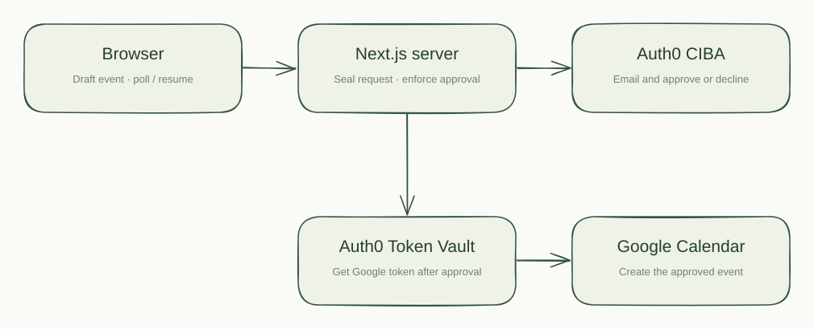

# Email approval for Google Calendar

An Auth0 learning demo: draft an event, approve it in your inbox with CIBA, and let the app use Token Vault to write to your primary Google Calendar. Unlike the [Google Token Vault sample](https://github.com/focusOtter/google-token-vault), this demo adds a one-time approval before a write. It uses no LLM and sends no meeting invitations.

**Topics:** auth0, ciba, asynchronous-approval, token-vault, google-calendar, nextjs



## Run locally

Use Node 24 and pnpm. Copy `.env.example` to `.env.local` and fill in the values. Generate `AUTH0_SECRET` with `openssl rand -hex 32`.

1. Create a **Regular Web Application** with a client secret (Post) on a tenant that supports CIBA email and Token Vault. Allow `http://localhost:3000/auth/callback` as a callback; allow `http://localhost:3000` for logout and web origins.
2. Enable Authorization Code, Refresh Token, CIBA (`urn:openid:params:grant-type:ciba`) and Token Vault (`urn:auth0:params:oauth:grant-type:token-exchange:federated-connection-access-token`). Enable **email** as a CIBA notification channel. The app requests 600 seconds: Auth0 uses email for requests over 300 seconds when enabled. Use Auth0's built-in email provider for testing; production needs a configured provider and Asynchronous Approval template.
3. Under your app's API access, authorize the Auth0 My Account API with `create:me:connected_accounts`. Use a non-rotating, time-limited refresh token and a Multi-Resource Refresh Token policy for the tenant's `https://YOUR_AUTH0_DOMAIN/me/` audience with that scope. Sign in again after changing grants.
4. Use a Google OAuth web client with the **Calendar API** enabled. Add your test user to the Google consent screen and allow the Google callback displayed by Auth0 (usually `https://YOUR_AUTH0_DOMAIN/login/callback`). Configure a Google social connection for **Connected Accounts / Token Vault**, allow offline access and `https://www.googleapis.com/auth/calendar.events.owned`, and enable the connection on this app. Set `AUTH0_GOOGLE_CONNECTION` to its name. Do not add write scopes to Orbit's or another demo's shared connection.
5. Enable a login connection. Sign in using a verified email address you can access. The signed-in Auth0 subject is the approver; this demo never redirects approval to an arbitrary email or tenant-wide demo account.

See [Auth0 CIBA app configuration](https://auth0.com/docs/get-started/applications/configure-client-initiated-backchannel-authentication), [Token Vault configuration](https://auth0.com/docs/secure/call-apis-on-users-behalf/token-vault/configure-token-vault) and the [Google Token Vault setup guide](https://docs.google.com/document/d/1K1GCk2OE8vrYr_nVa2ut4Zlzv-ME5Unuqyf2UFj7we4/edit) for details.

```sh
corepack pnpm install --frozen-lockfile
corepack pnpm dev
```

## Try the approval

1. Click **Connect Google Calendar**, allow Calendar access, and return to the app.
2. Enter an event title, future start time in **UTC**, and duration. Click **Request email approval**. Note the matching binding message in the app and the email review.
3. Open the email in your inbox and approve through Auth0. Return to the app and wait for **Approved · Event created**, then open the event in Google Calendar. Repeat with **Decline** or let the request time out; neither should create an event.

## What the demo verifies

- The server binds the event details and Auth0 request ID in a short-lived, encrypted HTTP-only cookie. Refreshing in the same browser resumes polling; closing the tab pauses it. This is not a durable background queue.
- Polling uses the provider interval and backs off on `slow_down`. No Calendar write runs until Auth0 approves. There is no route that accepts an event payload after approval.
- CIBA verifies consent for the event; it does **not** mint the Google token. After approval the server uses the same user's Auth0 session to retrieve a Google token through Token Vault. The Calendar API handles the connected account's Google permissions.
- Auth0's CIBA response is single-use, and the Calendar write includes a stable event ID. If the app cannot confirm the write, it doesn't retry automatically. Check Calendar before making a new request.

```sh
corepack pnpm test
corepack pnpm lint
corepack pnpm build
```
